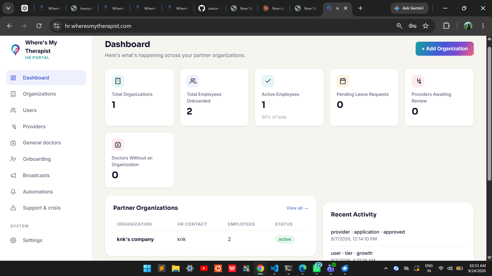

# Where's My Therapist — Web Platform

## Overview

**Where's My Therapist** is a web-based platform designed to help users discover and connect with therapists based on their requirements and preferences.

I am currently working on the **Where's My Therapist website and application as the sole Web Development Intern**, where I am responsible for developing and maintaining the web platform and implementing user-facing functionality.

This repository is a **sanitized demonstration version** of the project prepared for public viewing. The production application contains private configuration, credentials, API keys, payment credentials, and service integrations that are intentionally excluded from this repository for security and confidentiality reasons.

---

## Internship / Professional Contact

**Role:** Web Development Intern  
**Project:** Where's My Therapist  
**Official Work Email:** `kanak@wheresmytherapist.com`

The above email address was provided to me by the organization for internship/project-related communication.

---

## Live Website

🌐 **Production Website:**  
https://wheresmytherapist.com/

The live URL represents the actual project currently being developed and maintained.

This GitHub repository is a **public demonstration/sanitized version** created for showcasing the web development work while keeping production credentials and sensitive configurations private.

---

## Project Features

The platform includes functionality such as:

- User authentication
- Therapist discovery
- Therapist profiles
- Therapist/provider workflows
- User-facing web pages
- Administrative dashboard
- Responsive web interface
- Database integration
- External API integrations
- Video consultation functionality
- Payment-related integration

---

## Admin Dashboard

The actual production project also includes an administrative/HR dashboard for managing platform-related operations.

### Admin Dashboard Preview



The screenshot above demonstrates the interface of the production administrative dashboard.

> Note: Production credentials, private data, API keys, and sensitive configurations are not included in this repository.

---

## Technology Stack

### Frontend

- Next.js
- React
- TypeScript
- Tailwind CSS
- HTML/CSS

### Backend & Database

- Next.js server-side functionality
- Supabase
- PostgreSQL
- Server-side API routes

### External Services / APIs

The production application integrates with several external services, including:

- **Supabase** — Authentication and database functionality
- **Daily** — Video/communication functionality
- **Razorpay** — Payment-related functionality
- Other project-specific APIs and services

Sensitive credentials and private API keys are intentionally excluded from this public repository.

---

## Repository Structure

```text
Whereismytherapist_web_PUBLIC/
│
├── app/                    # Next.js application pages and routes
├── components/             # Reusable React components
├── lib/                    # Utilities and service integrations
├── public/                 # Images and static assets
│   └── admin-dashboard.png # Admin dashboard screenshot
│
├── package.json
├── package-lock.json
├── next.config.mjs
├── tsconfig.json
├── .gitignore
├── .env.example
└── README.md